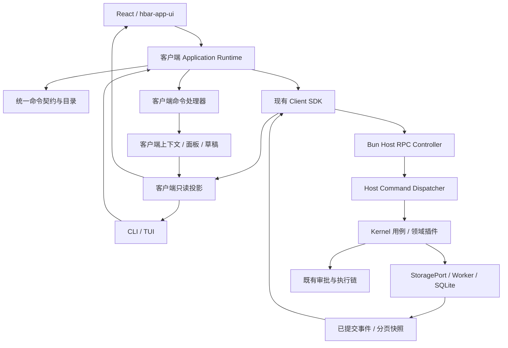

# hbar 命令优先架构与两阶段重构方案

状态：设计提案，尚未实施。基于 2026-09-16 工作树、HEAD `6248a95` 及当时已有未提交改动核对。本文重新规定本次重构的目标模式；[架构说明](architecture.md)、[CLI](cli.md) 与 [UI 集成清单](app-ui-integration.md) 继续作为现状参考，不能把本提案当作已交付能力。

## 1. 产品目标与架构决策

hbar 的功能由可发现、可校验、可执行的命令定义。按钮、快捷键、命令面板、CLI、TUI 和插件是这些能力的不同入口。业务功能必须在没有 React、浏览器和桌面窗口的情况下工作。

整体采用：**命令注册表 + 读写分离 + Host 领域服务 + 独立客户端应用运行时 + 只读状态投影 + schema 驱动界面**。读写分离落实为代码边界，继续使用现有 Bun Host、Storage Worker、SQLite 和 JSON-RPC over WebSocket，无须引入另一套传输或分布式基础设施。

以下决策固定为设计基线：

1. 命令 ID 是稳定字符串，例如 `session.setBudget`；参数是独立的结构化数据。完整文本只存在于 CLI、控制台、历史展示和复制入口。
2. Command 表示请求执行；Event 表示已经发生的事实。一个命令在指定执行域中只有一个执行器，事件可以有多个只读订阅者。
3. 查询与命令共用能力目录、参数契约、鉴权和输出体系，但查询没有业务写入权限。`settings.getThinkingLevels` 是查询操作。
4. UI 通过只读状态接口取得数据，通过命令改变共享状态。组件不持有原始 ClientTransport、数据库端口或 store 写入能力。
5. 当前会话、逻辑面板、跨组件草稿等应用状态从 React 中抽离；它们仍然属于各自客户端，不能变成 Host 全局单例。
6. 悬停、输入法组合、拖拽过程、普通树展开等组件内部交互可以保留局部状态。打开/关闭窗口、页面、对话框和工具面板明确纳入命令。
7. 第一阶段完成命令和 CLI 的完整功能闭环，以及旧 UI 写入路径清理；第二阶段再用 `hbar-app-ui` 重建工作台。每个阶段都有独立退出条件。

## 2. 已核对的现状与复用边界

| 现状                                              | 证据                                                                                         | 重构方式                                                     |
| ------------------------------------------------- | -------------------------------------------------------------------------------------------- | ------------------------------------------------------------ |
| 已有 Host、typed RPC、Client SDK、Storage Worker  | `apps/host/src/server.ts`、`packages/client/src/index.ts`、`packages/contracts/src/index.ts` | 保留通信和持久化基础，提取命令执行入口                       |
| 已有 CLI/TUI 和共享终端注册表                     | `apps/cli/src/*`、`packages/terminal/src/index.ts`                                           | 保留入口与兼容别名，收敛分散的执行逻辑                       |
| Web 命令面板存储带闭包的 `PaletteCommand.execute` | `apps/web/src/command-model.ts`、`workbench/command-descriptors.ts`                          | 面板变成注册表消费者，执行器移入应用运行时                   |
| Web、CLI 和终端仍分别分派功能                     | `apps/web/src/TerminalPanel.tsx`、`apps/cli/src/commands.ts`                                 | 统一为结构化 invocation，删除重复业务分支                    |
| 组件可以直接改共享 store                          | `apps/web/src/App.tsx` 中的 `useWorkbench.setState`；`stores.ts` 导出的可写 stores           | 内部 vanilla stores，公开只读 facade；业务和导航写入改为命令 |
| 设置实现同时承担表单、网络和副作用                | `apps/web/src/Settings.tsx`                                                                  | 抽出 Host 设置服务、schema、客户端表单会话和视图适配         |
| 已有受控工作台、会话、提示词、用量等生产组件      | `packages/hbar-app-ui/src/production.ts`                                                     | 按生产子入口复用，继续隔离 catalog、预览数据和夹具           |
| 已接入 lint 和严格 TS 选项                        | 当前 `package.json`、`tsconfig.json`                                                         | 维持门禁，不照搬旧文档中“尚未接入”的历史描述                 |
| 预算已有特定业务语义                              | `plugins/budget/src/index.ts`                                                                | 保留预算账本、使用量和增加上限规则，不把它降格为普通设置字段 |

当前终端注册表会把命令名转为小写，终端命令 schema 也只接受小写。本方案采用用户要求的 `namespace.camelCase` 作为规范 ID，因此必须同步迁移解析器、schema、SDK、贡献清单和补全；不能只改展示文字。旧 `/switch` 等命令通过显式别名映射兼容，不再对任意插件命令做隐式大小写折叠。

实施前建立逐功能清单，覆盖按钮、菜单、快捷键、对话框提交、CLI 分支、RPC 和插件贡献；每项记录命令 ID、目标、状态归属、权限、读写类型、无界面支持、测试与迁移状态。已有浏览器/计算机能力、文件附件、配对、设备、插件、目标、计划和预算均需列入，避免重建主界面时丢失既有能力。

## 3. 运行与依赖模式



该图表示运行数据流。源码依赖通过 contracts 和公开端口保持单向；领域服务不导入客户端运行时，组件不导入 Host 或 kernel。

| 模块                             | 目标职责                                                                                                                          |
| -------------------------------- | --------------------------------------------------------------------------------------------------------------------------------- |
| `packages/contracts`             | 可序列化的命令描述、schema、invocation、结果、错误、事件、状态 DTO、设置 schema；不存执行函数或 React 类型                        |
| 新增 `packages/commands`         | 平台无关的注册表、参数解析、别名、调用校验、目录合并与补全；Host 和客户端共用机制，各自注册执行器                                 |
| 新增 `packages/app-runtime`      | 每客户端实例的上下文、命令路由、Zustand vanilla 投影、草稿、表单会话、逻辑 surface 状态和订阅生命周期；不依赖 React、DOM 或 Tauri |
| `packages/client`                | 现有传输、请求关联、握手、订阅和重连；保持不依赖 Zustand/React                                                                    |
| `apps/host`                      | 认证、Controller、组合根、平台服务装配；不在 RPC switch 中堆业务规则                                                              |
| `packages/kernel`                | Host 命令分派、用例、事务边界、执行调度和领域规则；继续通过公开服务访问能力插件                                                   |
| `packages/storage`               | 命令回执/幂等记录、事件、投影、设置覆盖记录与迁移的 StoragePort 实现                                                              |
| `packages/terminal`              | 文本输入、兼容 slash 命令、终端输出适配；逐步移除第二套业务注册表                                                                 |
| `apps/cli`                       | argv/stdin、交互模式、结构化输出与本地进程生命周期                                                                                |
| `apps/web`                       | React adapter、ViewModel selector、i18n、组件组装、布局 renderer、浏览器平台适配                                                  |
| `packages/hbar-app-ui`           | 受控视图、类型化内容和回调；不感知 store、Host 或领域执行器                                                                       |
| `packages/ui-sdk` / `plugin-sdk` | 分别提供客户端/Host 能力注册、只读状态、命令调用与作用域释放                                                                      |
| `apps/desktop/src-tauri`         | 原生窗口、托盘、文件选择与 Host 启停连接；不承接会话业务                                                                          |

按领域拆分 contracts 和 runtime 的源码文件，保留明确公开导出。先交付真实共用模块，不创建只有转发函数的空层级。

## 4. 命令、查询和事件契约

### 4.1 三类消息

| 类型     | 示例                                                           | 执行和保存语义                                               |
| -------- | -------------------------------------------------------------- | ------------------------------------------------------------ |
| 业务命令 | `session.setBudget`、`run.submit`、`approval.resolve`          | Host 校验并执行；返回回执，必要时产生持久事件                |
| 应用命令 | `app.setSession`、`app.openPanel`、`app.openSettings`          | 指定客户端的运行时执行；改变客户端上下文或 surface 状态      |
| 只读查询 | `session.list`、`settings.getThinkingLevels`、`metrics.query`  | 返回有类型数据，不提交业务修改                               |
| 事实事件 | `session.budgetChanged`、`run.completed`、`app.sessionChanged` | 执行后由状态所有者产生；消费者不能发布伪造事实来修改核心状态 |

对用户来说都可以输入名称调用；内部必须区分 `kind: command | query`、`execution: host | client | platform` 和 `stateEffect`。它们是独立维度，例如客户端状态命令不写 Host，但仍不是查询。

核心领域命令由核心契约声明；插件命令由自己的 schema 和命名空间声明。目录是所有注册项的联合视图，不能变成依赖所有插件实现的中央大文件。

### 4.2 描述与参数

以下为目标契约示意，不代表已有 SDK：

```ts
const setBudgetDefinition = {
  id: 'session.setBudget',
  version: 1,
  kind: 'command',
  execution: 'host',
  category: 'session.budget',
  titleKey: 'commands.session.setBudget.title',
  descriptionKey: 'commands.session.setBudget.description',
  target: 'session',
  inputSchema: setBudgetInputSchema,
  outputSchema: sessionBudgetSchema,
  cli: { positional: ['tokens'] },
  form: { schemaId: 'commands.session.setBudget' },
  capabilities: ['session.budget.write'],
  idempotency: 'required',
  concurrency: 'per-session',
  availability: 'budget.available',
  surfaces: ['palette', 'cli', 'tui', 'api'],
}
```

目录发布可序列化 schema 描述；Zod 等运行时对象留在代码注册端。元数据还要表达敏感字段、输入上限、超时、取消能力、确认策略和插件所有者。复杂可用性由具名只读检查提供，不能把任意 JavaScript 放进描述文件。

内置命令从 schema 推导输入、输出和 CommandId 类型，静态调用具有类型检查；文本、网络和第三方扩展入口都做运行时校验。动态插件不能因此退回无校验的 `Record<string, unknown>` 执行。

文本入口在上下文解析后冻结 sessionId：

```text
session.setBudget 120000 --session session_123
```

代码入口不拼接命令字符串：

```ts
await commands.execute('session.setBudget', {
  sessionId: 'session_123',
  tokens: 120000,
})
```

`--session`、`--workspace`、`--context` 等保留为统一目标参数；表单在打开时绑定实体 ID 和版本。异步期间切换会话不会改变提交目标。

### 4.3 invocation、回执与幂等

每次调用携带协议版本、命令版本、`requestId`、规范命令 ID、已解析目标、参数和可选 `expectedRevision`。会产生持久副作用的调用有独立 `idempotencyKey`。客户端来源只用于审计与反馈，实际身份由已认证连接注入，不能信任客户端自报的 actor 或权限。

状态分为本地校验中、已提交、已受理、运行中、已成功、已失败、取消已受理、已取消及结果未知。短命令返回确定结果与提交版本；长任务尽快返回 `operationId`，使用 `operation.get/watch/cancel` 查询和控制。断网后的未知结果不会显示成功，也不自动使用新标识重放。

Host 保存有副作用命令的回执和幂等记录：同一作用域、身份、幂等键与相同规范载荷返回既有结果；同键不同参数报冲突。领域修改、事件、序号和可恢复回执应在可行的事务边界内提交。外部进程和网络副作用继续走意图日志，不承诺无法保证的全局 exactly-once。

幂等保留时间必须公布；超过可核对窗口返回明确的未知/过期状态，由用户核实，不无条件执行。日志记录关联 ID、耗时、目标和错误码；凭据与敏感正文按契约脱敏。

### 4.4 执行流水线

1. 解析规范命令 ID、别名和语法；保留空字符串、引号、Unicode 与 Windows 路径语义，不执行 shell 展开。
2. 检查命令版本、能力可用性，冻结目标上下文，解析名称为 ID。
3. 校验输入、权限、预期版本、幂等键和领域前置条件。
4. 执行用例；涉及工具或其他受保护副作用时复用既有最终参数校验、审批、意图日志及结算链。
5. 提交事实并返回回执；事务提交后发布事件。
6. 投影按版本应用结果/事件，命令状态在原操作位置更新。结果和事件先后到达都不应造成重复或回退。

同一实体的冲突写入串行或采用乐观并发控制，不同 Session 保持有界并发。取消沿 AbortSignal 和执行端口传播；取消已受理不等于外部进程已经停止。

## 5. 状态归属与 UI 写入禁令

| 状态类别                                                              | 唯一所有者                   | UI 读取               | 改变方式                                           |
| --------------------------------------------------------------------- | ---------------------------- | --------------------- | -------------------------------------------------- |
| Workspace、Session、Run、消息、审批、用量、预算、计划、目标、有效设置 | Host 领域服务及存储          | 只读客户端投影/查询   | Host 命令                                          |
| 当前工作区/会话、逻辑页面、工具面板、对话框参数、命令执行状态         | 每客户端 Application Runtime | 只读 app state        | `app.*` 命令或运行时内部生命周期                   |
| 草稿、表单字段、校验结果、dirty 状态、基线版本                        | 客户端 Draft/Form Runtime    | 只读 draft/form state | `draft.*`、`form.*` 客户端命令                     |
| 连接、已应用游标、请求状态                                            | Client SDK 与投影同步器      | 只读连接状态          | 运行时内部事件处理；用户重连经 `connection.*` 命令 |
| 布局恢复描述、设备偏好                                                | 客户端运行时与持久化适配器   | 只读布局/偏好投影     | 显式命令或布局适配器提交                           |
| hover、光标、IME 组合、拖拽临时坐标、树展开                           | 组件或 renderer 私有状态     | 组件内部              | 局部 UI 更新                                       |

内部使用 Zustand vanilla；React hooks 只负责订阅。公共 facade 暴露 selector、`getSnapshot` 和 `subscribe`，不暴露 `setState`、原始 StoreApi、mutable Map 或可变实体引用。类型只读还需结合封装、开发期冻结和依赖检查，不能仅把类型写成 `Readonly`。

ViewModel 负责将只读投影与命令回执转换成 props，action 只是绑定目标并调用命令。网络同步器和命令处理器持有内部写入端口。并非所有服务端事件都要“再发送一条命令”才能投影，否则会制造反馈循环。

草稿键包含 Host/工作区/会话/表单实例；面板绑定明确 sessionId。面板关闭、快速切换、旧响应迟到或连接换代时，只更新仍然匹配的目标。正在编辑的草稿不会被 usage 通知覆盖。

拖拽中间帧、树展开不进入公共命令目录。需要保存布局时，renderer 向运行时提交描述；窗口和子界面的 open/close 即使由 Escape 或关闭图标触发，也执行对应应用命令。字段输入使用轻量本地 `form.setField`，不逐键往返 Host，也不把每次打字保存为业务审计记录。

导入边界检查禁止 View 导入可写 stores、ClientTransport 和领域私有文件。新 UI SDK 只提供读取、查询、执行命令和受控渲染扩展；旧 `api.client` 的写操作在迁移期通过适配层汇入 dispatcher，最终移除 UI 插件绕过命令的入口。

## 6. 上下文、导航与 CLI 一致性

`app.setSession <id|name>` 在当前 workspace 内解析会话；跨 workspace 使用显式参数。同名结果不挑第一个，而是返回候选与歧义错误。未找到、已归档或没有权限分别返回明确状态。解析成功后使用稳定 ID，后续改名不影响目标。

交互式 CLI/TUI 的当前上下文属于该进程；Web 属于对应 client/window。一次性的 `hbar exec app.setSession ...` 默认不会改变另一个 CLI 进程，更不会替其他窗口切换会话。需要跨调用持久上下文时显式指定 `--context <name>`；自动化脚本优先每条命令提供 `--workspace` 和 `--session`。

建议入口：

```text
hbar commands list --category session
hbar commands describe session.setBudget --json
hbar exec app.setSession "审查会话" --workspace workspace_1 --context dev
hbar exec session.setBudget 120000 --session session_123
hbar exec session.getBudget --session session_123 --json
hbar exec run.submit --session session_123 --input-file prompt.md --jsonl
hbar exec settings.get --scope session --session session_123 --path provider.model
hbar exec settings.set --scope session --session session_123 --path provider.model --value-json '"model-id"'
hbar exec app.openPanel --panel files --session session_123 --client client_1
hbar repl
```

这些是拟定语法。沿用现有 CLI 的稳定退出码分类，新增错误码纳入同一契约；stdout 的 JSON/JSONL 不混入日志或 ANSI，诊断进入 stderr。无 TTY 时缺参数返回结构化校验错误，不挂起等待表单；审批也遵守已有显式模式。

应用命令的跨客户端控制要通过已鉴权的定向控制能力：显式指定已连接 client/window，检查其公布的 surface capability，转发请求并等待该客户端回执。不得广播“打开面板”。没有对应 GUI 时返回 `CAPABILITY_UNAVAILABLE`，并可给出相关查询命令；业务命令仍可完全无界面执行。

`app.openPanel` 与 `app.closePanel` 使用稳定 panel instance ID，重复 open 聚焦已有实例。`toggle` 可以作为用户快捷动作，但脚本使用显式 open/close，保证重试可预测。CLI 关闭或 UI 断线不取消 Host Run。

## 7. 分类命令面板与参数表单

面板从注册表生成，不手工维护另一份功能清单。目录至少包含：

| 分类         | 代表操作                                                                                                                           |
| ------------ | ---------------------------------------------------------------------------------------------------------------------------------- |
| 应用与导航   | `app.setWorkspace`、`app.setSession`、`app.openPanel`、`app.closePanel`、`app.openSettings`、`app.openStatus`、`app.restoreLayout` |
| 工程与会话   | `workspace.create/open`、`session.create/rename/archive/fork/export`、`session.list`                                               |
| 运行与审批   | `run.submit/cancel/retry`、`approval.resolve`、`questionnaire.answer`                                                              |
| 模型与预算   | `session.setModel`、`session.setThinkingLevel`、`session.setBudget`、`session.getBudget`                                           |
| 目标与计划   | `goal.create/update/clear`、`plan.update/clear`                                                                                    |
| Agent        | `agent.create/list/cancel` 与父子 Session 查询                                                                                     |
| 文件与工具   | `file.list/read/write`、附件操作、已有 browser/computer 能力                                                                       |
| 设置与供应商 | `settings.get/set/unset/apply`、provider/model 配置与动态选项查询                                                                  |
| 监控与 Git   | `metrics.query/watch`、`usage.query`、`git.status/diff/log/stats`                                                                  |
| 系统与扩展   | 连接、配对、设备、插件、诊断和路径管理                                                                                             |

分类使用稳定 ID 和 i18n key。按钮、快捷键和历史项引用同一个 command ID。只呈现已交付且当前作用域合法的命令；可用性变化显示原因，并在执行端再次检查。

带参数命令通过 schema 生成表单：选择命令 → 绑定目标 → 填写参数 → 校验/预览 → 执行 → 原位结果。参数齐全的按钮或文本命令直接调用同一执行器。打开预算编辑器是应用命令，保存预算是 `session.setBudget`，两者不混成隐含副作用。

补全使用只读查询，支持取消和有界结果。面板保留分类、搜索、当前目标、不可用原因、参数提示、进度、错误和重试。命令与 UI 表单共享约束；提交后以 Host 校验为最终结论。

`form.setField`、焦点恢复、投影同步等内部操作不污染用户命令面板。目录通过 surfaces 和 visibility 声明公开范围；“所有入口可命令化”不等于“所有内部操作都列在面板中”。

## 8. Schema 驱动设置系统

### 8.1 三层声明

设置定义分为数据 schema、展示 schema 和行为绑定，三者在版本化描述文件中关联：

- 数据 schema：字段类型、数组项、nullable、默认值、数值/长度范围、枚举、可覆盖层级、持久化目标、敏感性与生效时机。
- 展示 schema：i18n label/help、组件 ID、分组、顺序、List、ComboBox、文件/目录选择器和子编辑器 ID。
- 行为绑定：动态内容查询、依赖字段、校验查询和提交命令。这里只保存名称与参数映射，不保存函数、任意表达式或模块路径。

供应商 List 的条目使用稳定 providerId。`element: ProviderDialog` 表示用白名单 editor registry 中的组件编辑该条目。定制组件仍接收受控 props、字段状态和命令回调，不能获取网络/写库能力。纯 CLI 通过相同字段契约完成配置，不依赖定制 Dialog。

### 8.2 动态内容示例

用户示例中 `multiple: true` 表示存储数组，应归一为数组 schema；若表达“从多个思考等级中选择一个”，实际字段应为 nullable string、单选。以下保留真正的多选语义，并修正 `lable` 为 `label`：

```json
{
  "name": "thinkingLevels",
  "label": "i18n:settings.thinkingLevels",
  "type": "array",
  "items": { "type": "string" },
  "nullable": true,
  "default": null,
  "component": "ComboBox",
  "multiple": true,
  "metadata": {
    "get_content": "settings.getThinkingLevels",
    "dependsOn": ["provider.id", "provider.model"],
    "resultSchema": "settings.optionList.string",
    "applyMode": "nextRun"
  }
}
```

示意注册：

```ts
const settings = registry.namespace('settings')

settings.registerQuery('getThinkingLevels', {
  input: thinkingLevelQuerySchema,
  output: stringOptionListSchema,
  execute: ({ data, path }, context) => modelCapabilities.getThinkingLevels(data, path, context.signal),
})
```

`data` 是经 schema 校验、按依赖和权限裁剪的只读 SettingsForm 数据；`path` 使用字段路径与稳定条目 ID，不使用重排后会变义的数组下标。服务端把草稿覆盖到合法的有效设置上计算候选项；凭据不作为表单数据发回客户端或任意 callback。

返回契约包含 `options: { value, labelKey/label, disabled, reason }[]`、依赖指纹/版本和能力状态，可有分页游标。类型定义 options 的值类型，Host 验证返回数据，UI 提供 empty/loading/error/retry 状态，不把查询失败当作空选项成功。

`dependsOn` 构成无环依赖图。provider/model 改变后，运行时取消过时请求，缓存键包含 schema 版本、作用域、provider/model、身份权限及依赖值；用 form revision 和请求代次拒绝旧响应。加载选项不自动修改用户已选值；旧值失效时明确标记，提交前要求修正或显式重置。

在保存时 Host 再校验当前模型能力与字段约束，防止绕过表单或使用陈旧选项。schema callback 默认只读、可取消、有超时和返回大小限制，不允许借渲染查询触发修改。可信插件的只读声明不能被当作恶意插件沙箱保证。

### 8.3 全局、工作区、会话 override

有效值优先级：`schema 默认值 < 全局覆盖 < workspace 覆盖 < session 覆盖`。解析与约束的权威实现位于 Host；UI/CLI 获得相同 effective value 和来源报告。

必须逐字段规定：

- 未设置表示继承；`null` 是 schema 允许的显式值，不等于继承；`settings.unset` 删除本层覆盖。
- 对象按声明字段解析；数组默认整体替换。需要按 ID 合并的 provider 列表必须明确 keyed merge 策略和唯一键，禁止按数组位置隐式合并。
- 字段声明允许哪些层级覆盖。Host 路径、设备凭据等不自动获得 session 覆盖权限。
- 展示本层值、有效值、来源层级、继承关系、校验错误和是否待生效。恢复继承与恢复默认是两种显式操作。
- 保存通过 `settings.apply` 提交一组 set/unset 变更，校验后原子应用，避免供应商与模型只更新一半。
- 基线版本包含受影响层级及继承依赖版本；其他客户端修改本层或上层后，返回冲突/重校验结果，不默默覆盖。
- 编辑草稿与已提交设置分离。保存失败保留草稿；外部变化保留用户修改并提示合并，不重置整个表单。

主题、语言、窗口布局属于 device/client profile，是与 Host 全局设置不同的持久化维度。可以在同一个设置 UI 展示，但每个字段必须声明归属，不能让远程 Host 的修改无意改变所有设备的界面。

每个字段声明 `immediate | nextRequest | nextRun | restart`。Run 记录所用设置版本；普通默认值变化不改写历史。权限撤销等即时安全约束仍立即生效。预算属于有执行效果的领域对象，由预算服务处理。

文件与目录选择器声明路径所在环境：客户端本地、Host 或 workspace。远程 Host 路径用 Host 文件查询/选择；客户端本地文件通过上传形成 artifact，不能把浏览器文件路径当作服务器路径使用。秘密值使用凭据端口和引用，不进入普通设置快照、补全、命令历史或日志。

## 9. 预算与配置的区别

`session.setBudget <tokens>` 明确表示设置本预算账本的总上限，不是“再增加这么多 token”，也不清零已用量。预算服务应返回 limit、used、remaining、phase 和 revision。

当前预算实现只允许创建或提高活动预算上限，且存在 completed/stopped 限制；第一阶段先保留这些规则并在 schema/领域错误中表达。降低上限、重置账本或更改消耗口径需要独立命令与迁移决策，不能借命令重构悄悄改变。

当前实现按 usage 事件计算 `max(input - cacheRead, 0) + output` 并结算；重构应保留和版本化口径，核对供应商归一后字段是否包含缓存。全局/工作区中的“新会话默认预算”只是创建策略，与既有 Session 的运行预算分开。

预算耗尽限制必须明确检测时间与无法预知的在途消耗。保留现有检查语义并报告，不能仅凭名为“上限”就宣称供应商请求绝不会超额。

## 10. 事件、投影与可靠增量同步

复用现有协议通道。增加命令目录、执行/查询、状态订阅等具名 RPC；统一入口仍然校验按命令 ID 判别的输入和输出。旧 RPC 暂时作为同一用例/dispatcher 的适配器，不能形成第二条写入实现。

持久业务事件包括协议版本、eventId、实体 ID、实体单调序号、revision、request/operation 关联信息。客户端本地导航事件和高频遥测分开定义保留与恢复保证，不要求全部写入业务事件日志。

首次读取使用分页 snapshot 与一致游标，再连续订阅。缺口补取、重复去重、乱序有界缓存、游标过期重新快照；游标只推进到连续已应用位置。Host/连接换代使旧响应失效。业务投影可重新构建，UI 不是事实保存位置。

文本流使用 streamId、正文/思考分别的偏移与增量、明确偏移单位和 replace/reset 语义。流式终态与持久消息按 ID 衔接，不重复显示。按当前工作树检查链路，不因旧规范提及累计全文就假定现实现仍未改进。

订阅由运行时按消费者引用计数管理；隐藏页面释放重型订阅，侧栏另订阅轻量摘要。限频、最大帧/批次、分页、队列与缓冲上限在生产端执行。慢消费者只影响自身；持久事件缺失触发恢复，遥测丢样显式标记 gap。

## 11. 第二阶段的工作台组合

```text
AppShell
├─ AppSidebar
│  ├─ 顶部：应用与命令入口
│  ├─ 可滚动树：Workspace → Session
│  └─ 底部：Host 只读状态 / 状态中心按钮 / 设置按钮
└─ MainWorkspace
   ├─ 会话标题与当前目标
   ├─ AIChat：Markdown 消息与类型化活动内容
   ├─ PromptInput
   ├─ AIUsage（提示词输入下方）
   └─ 右侧工具栏 → 会话绑定的工具面板
```

AppShell 使用 `hbar-app-ui` 的生产组件；布局描述保存模块 ID、区域、顺序、尺寸约束与可见性，继续通过现有 FlexLayout 适配，避免另造竞争布局状态。普通内容使用语义 flex 流；只有真实浮层使用定位。第二阶段按 reference-flow 技能观察实际预览和响应式行为后实施。

### 11.1 侧栏

- Workspace 为一级、Session 为二级。展开是局部 UI 行为；选择 Session 执行 `app.setSession`。
- header/footer 不进入树的滚动区域；数据可分页/增量加载，大列表按稳定 ID 虚拟化。
- 展示会话运行/审批/未读摘要，后台流更新不让整棵树随每帧重绘。
- 删除、归档、刷新导致 active ID 失效时显示明确空态或契约规定的回退，不悄悄选择另一个会话执行原操作。
- 底部 Host 状态只读；状态按钮执行 `app.openStatus`，设置按钮执行 `app.openSettings`。

### 11.2 会话区

AIChat 接收判别联合 timeline item：message、activity、approval、toolCall、plan 等，以稳定 ID 关联业务记录。正文用现有 Markdown 安全渲染；不能靠正则解析模型文字决定是否出现审批卡或计划卡。卡片操作绑定 approvalId、runId、planId 等明确目标。

PromptInput 的草稿和附件状态归运行时；发送执行 `run.submit`，取消执行 `run.cancel`。输入法、光标、自动增长等属于 UI。发送中继续输入的草稿不会被上一条成功回执清空。AIUsage 从同一用量和预算投影读取，不再由组件自行累计。

右侧工具入口包括 File Manager、Monitoring、子 Agent、目标与计划、session settings。每个 panel instance 持有 sessionId，支持明确的“跟随当前会话”或“固定目标”策略；默认跟随策略也要在切换时取消过时加载并保留各会话草稿。

Agent Activity、Approval、Tool Calls 与 Plan 是可交互的真实投影，包含空态、失败、取消、恢复和跳转关联对象。子 Agent 使用独立子 Session，显示父子关系、状态、预算归属和取消传播策略。

### 11.3 设置区

左侧 schema 分组导航，右侧 SettingsForm；顶部提供全局/workspace/session 作用域和来源信息。provider 列表打开声明的 ProviderDialog；普通字段与定制 editor 共用字段契约、草稿、验证、override 和保存命令。

### 11.4 呈现契约

宿主解析类型化 i18n 文案和格式化器，组件只渲染内容与回调。icon 使用 xs/sm/md/lg/xl 语义档位。预览和测试数据留在 preview/fixture，不进入生产导入图。

窄屏使用同一模块与状态契约，把工具区呈现为可返回的单面板或抽屉；不能通过隐藏功能完成适配。焦点、键盘、Escape、错误和进度反馈靠近原操作。

## 12. Dashboard、Usage 和 Git 数据能力

监控图表依赖的采集、归一、存储、查询与 CLI 导出在第一阶段落地，第二阶段只接入可视化。全局状态中心提供 Performance、Usage、Git 三个分区；Session Monitoring 是同一服务的 session/workspace 过滤视图。

| 领域     | 数据源与指标                                                                                   | 口径和边界                                                                                 |
| -------- | ---------------------------------------------------------------------------------------------- | ------------------------------------------------------------------------------------------ |
| 系统性能 | Host 采集器：CPU、内存、进程树、线程数/可用的线程 CPU、磁盘 I/O、网络收发、Host 事件循环与队列 | 区分整机、Host 与受管子进程；线程/进程明细受平台能力约束；缺数据返回 unavailable，不填 0   |
| 运行效率 | Run/Step/Attempt/ToolCall 事件：活动/排队数、并发、成功失败、工具耗时、总耗时                  | 单独记录排队、请求、工具、审批等待和整段 Run 时间，避免重复相加                            |
| AI 用量  | 归一化供应商 usage：输入、输出、cache read/write、模型维度、速率与估算费用                     | 结算数据与流式估算区分；价格保留来源、版本、币种、生效时间，未知费用为空                   |
| 请求延时 | 每 Attempt 的开始、首个响应/思考/可见正文、结束时间                                            | 首可见文本 TTFT 与首供应商事件分开；超时/取消单独分组，支持 p50/p95                        |
| Git      | Git 插件日志/diff 与 hbar 提交来源记录                                                         | workspace/repository 归属、提交次数、文件数、增删行时间序列；明确 merge/rename/binary 规则 |

建议定义：

- 输出速率优先使用供应商真实 token 与有效生成时段；仅收到最终 usage 时不伪造逐秒真实 token，估算需标记来源。
- “输入速率”默认指每时间窗内被请求接纳的 input tokens；供应商未提供 prefill 数据时不宣称这是模型预填充吞吐。
- 缓存命中率使用统一归一后的 `cacheRead / cacheEligibleInput`，分母为 0 返回无样本；不平均各请求百分比，不跨不兼容口径直接汇总。
- 用量按事件/Attempt ID 去重，模型和供应商维度保留；子 Agent 的独立与含后代聚合视图明确区分，避免重复计入。
- 无请求开始/首字时间的历史记录不补造 TTFT。系统 CPU 不能按 token 比例分配给会话；仅展示可观测的归属数据。
- 自动提交通过记录 `origin: auto | manual | external` 与 session/run/operation 关联识别，不从提交 message 猜测。只做统计不会自动开启提交计划。
- Git 历史按 repoId、commit ID 和时间口径聚合；明确 merge 使用哪个 parent、二进制不估行数、时区/桶宽和 rebase 后可达性。变更历史需可增量重索引，审计来源记录不因 rebase 被静默擦除。

采集器由 Bun Host 管理，通过受管平台适配器收集可用 OS 数据；原生辅助进程只提供采集能力，不承接业务。CPU/磁盘/网络使用差分计数和单调时钟，处理重启与计数回绕。共享一个采集任务服务多个订阅者，查询带时间窗、桶宽、过滤条件、分页及最大点数。

原始样本用有界环形缓存/保留窗口，长期保留分级聚合；用量与账务事实保留在持久账本。采样间隔、保留时长和容量作为明确配置，基准后设默认。前端不自行持续拉 OS/Git，不为一个图表广播全量历史。

## 13. 插件扩展模式

插件贡献 command/query、settings schema、panel/editor descriptor、只读投影和可选 UI renderer。每项有命名空间、版本、作用域与 disposer；注册冲突报错，不能覆盖核心命令。

Host 执行器负责业务能力，客户端执行器负责本地应用能力。没有 Host 实现的 client-only 命令不能因为元数据写 `headless: true` 就宣称可在纯 CLI 运行。schema、声明、执行器和 capability 必须一致。

禁用插件后移除执行器、补全、schema callback、面板和订阅；进行中的操作按其取消/结算策略收尾，已保存数据保留并标记该能力当前不可用。动态表单失去插件时保留草稿并阻止无效提交。

插件权限在调用时、订阅时和必要的执行边界检查；加载一次验证不替代后续权限变化。使用既有 Cordis scope 与资源释放规则，不引入任意全局服务容器。

## 14. 两阶段实施顺序与独立交付单元

### 第一阶段：命令、状态和 CLI 优先

| 单元                | 交付内容                                                                                  | 独立验收                                                                              |
| ------------------- | ----------------------------------------------------------------------------------------- | ------------------------------------------------------------------------------------- |
| A0 基线与映射       | 全功能入口/状态/命令清单，现有 CLI/RPC 行为、检查与未提交改动基线                         | 每个既有功能有所有者、迁移目标与测试；现有改动不被覆盖                                |
| A1 最小命令闭环     | 命令契约、解析器、注册表、Host dispatcher、runtime 骨架；先贯通 setSession/setBudget      | 同一预算操作可由 CLI、结构化 API 和最小 UI adapter 执行；命名迁移与冲突测试           |
| A2 可恢复执行       | 命令回执、幂等、版本冲突、长任务、取消、结果核对                                          | 重复请求、断线和崩溃不导致重复副作用或永久 pending                                    |
| A3 状态独立         | 将目录/会话/运行投影、上下文、草稿与同步迁到 app-runtime；只读 facade                     | 无 React 环境可创建多个 runtime；互不抢选中项，状态可恢复                             |
| A4 全功能命令化     | 逐领域迁移 session/run/approval/goal/plan/budget/files/providers/plugins/devices/既有工具 | 每个领域有 CLI 闭环，旧 RPC 和 UI adapter 汇入同一用例，无并行业务实现                |
| A5 Settings Engine  | schema、三层 override、动态查询、表单会话、批量提交和有效值报告                           | CLI 可查询选项、设置、撤销覆盖，冲突与旧响应正确处理                                  |
| A6 数据服务         | 性能采集端口、用量时序、Git 聚合与 CLI 查询/导出                                          | 无 UI 能获取真实数据；缺失能力、指标口径和容量上限可验证                              |
| A7 旧 UI 清理和封口 | 旧 UI 改为读取+命令 adapter；打开/关闭 surface 命令化；删除重复终端业务分支               | 静态依赖门禁与端到端检查确认无 View 直写业务/共享应用状态、无绕过 dispatcher 的写入口 |

A4 按领域拆成独立子提交，不能把所有领域积攒成一个提交。A7 的检查从 A1 起持续加入，A7 负责最终清除残留。第一阶段保留薄旧视图作为过渡，但不以此宣告第二阶段完成。

**第一阶段退出条件：** 关闭全部 GUI 后，CLI 能完成工程/会话、运行、审批、模型、预算、目标计划、文件、设置和已交付扩展能力；其结果可被重新连接的 UI 正确投影。UI 除声明的组件内部交互外，所有共享状态修改均经命令。新监控的数据能力可通过 CLI 核验。

### 第二阶段：hbar-app-ui 工作台

| 单元            | 交付内容                                                           | 独立验收                                                     |
| --------------- | ------------------------------------------------------------------ | ------------------------------------------------------------ |
| B1 Shell 与侧栏 | AppShell、Workspace→Session 树、固定底栏、导航和逻辑 panel adapter | 大列表可滚动、双窗口选择独立、布局恢复、窄屏可访问           |
| B2 会话主区     | AIChat、PromptInput、输入下方 AIUsage、活动/审批/工具/计划卡片     | 发送到结算、审批、取消、断线、草稿保留完整闭环               |
| B3 会话工具区   | Files、Monitoring、子 Agent、目标计划、Session Settings            | 面板正确绑定目标；切换/关闭/重开无旧响应污染；相同命令可复用 |
| B4 设置工作台   | schema sidebar+form、override、ProviderDialog、动态 ComboBox       | 动态依赖、校验、保存失败、并发修改和继承来源均可见           |
| B5 全局状态中心 | Performance、Usage、Git 图表与 drill-down                          | 所有数字来自 A6 数据；过滤/单位/空值/时间窗语义正确          |
| B6 替换与回归   | 删除被替换页面、样式和旧可写 API；生产/预览入口整理                | 功能清单全部闭合；全套检查、E2E、桌面 smoke 和窄屏截图       |

每个单元在检查通过后立即独立 Git commit；有同文件已有改动时通过明确文件/补丁隔离。采用增量适配的迁移方式，最终交付必须移除旧写入路径，不永久维护两套架构。

## 15. 验收矩阵与完成定义

| 维度       | 必须验证的可观察行为                                                                         |
| ---------- | -------------------------------------------------------------------------------------------- |
| 命令一致性 | UI、CLI、TUI、SDK 同输入/目标得到相同业务结果和错误；参数表单与 CLI 校验同源                 |
| 解析与选择 | 引号、空字符串、Unicode、Windows 路径、无效参数、旧别名、重名 Session、未知/失效目标         |
| 写入隔离   | View 与 UI 插件无法导入可写状态/直连业务传输；两个客户端的选择互不影响                       |
| 执行恢复   | 双击、同键不同参数、预期版本冲突、超时、取消、断线未知结果、重启与外部副作用核实             |
| 增量同步   | 重复、乱序、缺片、游标失效、慢客户端、连接换代；恢复投影等于 Host 快照                       |
| 设置       | null/unset/default、数组替换、允许层级、上层覆盖变化、原子保存、脏草稿、动态选项迟到/失效    |
| 插件       | 命名冲突、权限撤销、作用域失效、卸载 disposer、query 超时、无 headless 实现                  |
| 监控       | 单位、聚合窗口、样本缺失、缓存分母、usage 去重、费用版本、Git 来源、平台不可用和长期保留上限 |
| UI 内容    | 非默认语言、长文案、0/1/正常/边界/边界+1 条记录、重复/失效 ID、变更后原目标回调              |
| UI 交互    | 桌面/窄屏、键盘与焦点、滚动/虚拟化、IME、忙碌/失败/恢复、切换会话期间的提交                  |
| 性能       | 多 Session 并发、命令受理 p95/max、队列和推送字节上限；流帧不随历史长度同比膨胀              |

延迟基准沿用 [验证说明](testing.md) 的可重复方法，分别测本地导航、Host 命令受理、投影可见和业务完成时间；报告环境、样本和 p95/max，不混用模型生成耗时。

代码单元交付运行 `bun run check`；Web/UI 变更另做相关 build、E2E、截图和内容/图标/flow guards；协议、并发和持久化变更增加对应集成/恢复测试。最终进行完整回归和桌面验证。未运行、失败、平台不支持的项目如实记录。

本提案本身只做文档格式、链接与差异检查，不以业务测试通过为名义宣称架构已实施。

## 16. 首个实施切片

从 `app.setSession` 和 `session.setBudget` 开始，配套 `session.list`、`session.getBudget` 与 `app.openPanel` 的最小调用边界：

1. CLI 与 API 使用同一命令定义并冻结 Session 目标。
2. `app.setSession` 只改变所属 runtime，`session.setBudget` 复用现有预算服务。
3. UI 通过只读投影显示预算，打开编辑器经应用命令，保存经业务命令。
4. 覆盖两个客户端、重名 Session、提交后切换、重复设置、并发版本冲突和失败保留草稿。
5. 验证后独立提交，再推广到其余领域。

这个切片同时检验命令入口、状态所有权、CLI、Host、表单和 UI 读取边界，能在全面迁移前证明架构可用。
