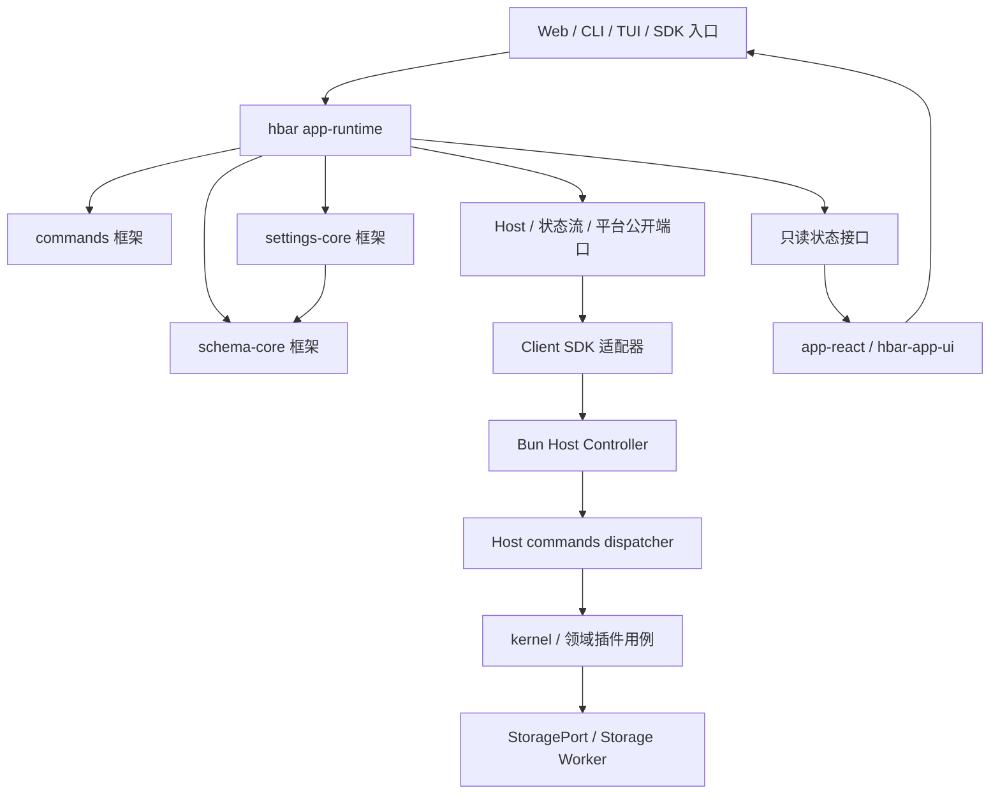

# hbar 命令、Schema 与工作台重构总计划

状态：第一阶段 A0–A15 与第二阶段 B1–B7 已完成。计划收尾于 2026-09-19，交付证据以[实施记录](implementation-progress.md)为准。原计划提交为 `7ae9740`，其实现基线为 `6248a95`；`6ec3b46` 将旧 Web 替换为结构性外壳。本方案分为框架包、hbar 业务装配与界面三个层次，并拆成可独立验收的子计划。

实施起点的工作树已存在其他未提交修改，全部切片因此都仅暂存自己的明确路径，没有 reset/stash 或夹带外部工作。`6ec3b46` 在基线时只挂载 AppShell/AppSidebar；后续 B1–B7 已在该外壳上补齐真实 Host/runtime 功能。[现有架构](../architecture.md)、[插件](../plugins.md)、[CLI](../cli.md)和[验证](../testing.md) 已更新为当前实现；本文保留最初的设计约束和切片结构。

## 1. 本次固定的设计方向

**先建立可脱离 UI 使用的命令、状态和设置能力，再用 `hbar-app-ui` 重建界面。命令机制和 Schema 设置机制必须成为 hbar 的独立框架包。**

1. 用户操作以稳定字符串名称调用，如 `session.setBudget 120000`、`app.setSession "审查会话"`。按钮、命令面板、快捷键、CLI、TUI 和扩展都是同一能力的入口。代码调用使用名称加结构化参数，文本语法只在输入边界解析。
2. 用户所说的 Event 字符串保留为具名调用方式；执行层区分 command、query 与 fact event。一个调用有明确执行器、输入输出、错误与回执；执行后的事实通知允许多个订阅者。不得用无结果的广播代替命令执行。
3. UI 只读状态接口。所有业务修改，以及会话选择、共享草稿、设置字段、窗口和子界面开关等应用状态修改，必须调用命令。原始 Zustand store、网络写接口、数据库接口不对 View 和 UI 插件公开。
4. 拖拽过程、hover、光标、IME、普通折叠展开等组件内部交互由 renderer 管理。打开/关闭窗口、页面、工具面板、定制设置子页面是明确特例，统一命令化。
5. 参数表单只是命令参数的编辑入口。参数齐全时 CLI 可以直接执行；缺参数时交互入口可用同一 Schema 提示填写。表单既不是业务实现，也不是执行命令的前置依赖。
6. 设置具备数据约束、展示描述、动态 callback、字段来源与多层覆盖。优先级为 `Schema 默认 < 全局 < 工作区 < 会话`；设备外观与窗口偏好另有明确归属。
7. hbar 应用核心以装配为主：注册命令、业务 handler、Schema、组件类型、callback、Zustand 状态模块及平台/服务器适配器。领域规则仍在 kernel 或领域插件中，不能搬进一个新的万能 runtime。

## 2. 阅读顺序与子计划

| 编号 | 子计划                                                       | 具体产出                                               | 依赖与完成界限                                                 |
| ---- | ------------------------------------------------------------ | ------------------------------------------------------ | -------------------------------------------------------------- |
| P0   | [框架包与模块边界](00-framework-boundaries.md)               | 包公开 API、依赖方向、组合根、版本与扩展边界           | 先冻结边界；每个包随首个真实行为落地，不批量创建空包           |
| P1   | [命令框架与统一目录](01-command-framework.md)                | 字符串命令、typed invocation、分类、执行回执、兼容适配 | 首先交付注册/解析最小部分；持久执行与 P2/P4 的实际用例一起验证 |
| P2   | [只读状态、应用运行时与 CLI](02-state-runtime-cli.md)        | 无 React runtime、状态所有权、CLI/TUI、窗口命令和同步  | 依赖 P1 最小契约；选会话和预算是首个贯通切片                   |
| P3   | [Schema 与分层设置框架](03-schema-settings-framework.md)     | Schema/Form 包、Settings 包、动态内容、原子 override   | 依赖 P1 调用端口、P2 表单宿主；CLI 先验收，React renderer 后接 |
| P4   | [Host 业务与监控数据](04-host-capabilities-observability.md) | 全领域 command handler、持久用例、性能/用量/Git 查询   | 与 P1/P2 按领域贯通；P3 接设置服务；全部数据先可由 CLI 核验    |
| P5   | [hbar-app-ui 工作台重建](05-app-ui-rebuild.md)               | Shell、侧栏、会话、工具、Schema 设置、状态中心         | 第一阶段退出门禁通过后实施完整工作台                           |
| P6   | [迁移顺序、验证与交付](06-migration-validation.md)           | 切片顺序、功能映射、删除条件、测试与逐提交规则         | 从第一项开始持续执行，负责两个阶段的封口                       |

子计划编号是主题编号，实施顺序见 P6；不能先做完一个庞大框架再首次验证业务。每份子计划均给出行为、公开边界、交付切片和验收条件。

## 3. 框架包与 hbar 的关系

新增包名称作为本次规划的规范名称；原计划的笼统 Settings Engine 拆为下面两个包。

| 包                    | 固化的机制                                                           | 不归它管理的内容                            |
| --------------------- | -------------------------------------------------------------------- | ------------------------------------------- |
| `@hbar/commands`      | 目录、命名、参数解析、类型校验、执行管线、回执协议、别名             | Session/预算规则、具体 RPC、React、SQLite   |
| `@hbar/schema-core`   | 描述校验、SchemaPath、字段约束、表单状态转换、动态内容依赖与类型报告 | 供应商模型知识、React 组件、hbar 三层存储   |
| `@hbar/settings-core` | 层级覆盖、来源追踪、变更集、版本冲突、保存计划与迁移机制             | 固定设置清单、数据库实现、模型/预算副作用   |
| `@hbar/app-runtime`   | hbar 客户端上下文、私有 Zustand、投影、逻辑面板、表单/草稿、命令路由 | React/DOM/Tauri、供应商执行规则、另一套协议 |
| `@hbar/app-react`     | 只读 hooks、命令与表单绑定、Schema component/editor renderer 注册    | 可写 store、业务执行器、传输和持久化        |

`packages/contracts` 继续承载 hbar 领域与网络 DTO，引用上述框架的基础类型；框架基础包不反向依赖 hbar 领域 contracts。`packages/client` 保留传输、关联、连接与恢复。`packages/kernel`、`packages/storage`、领域插件继续承担业务及事实持久化。`hbar-app-ui` 保持受控组件包。



此图表示调用和数据流；源码依赖及端口所有者以 P0 为准。UI 数据读取和用户发起的修改走两条明确路径，服务端事件应用投影不会再反向发命令。

## 4. 两个阶段的范围

### 第一阶段：清理旧界面逻辑，命令与 CLI 完整可用

- 从当前功能清单出发，将业务与共享应用状态移出 View，建立私有 Zustand vanilla 状态与只读 facade。
- 贯通命令目录、结构化调用、Host 用例、回执、投影、CLI/TUI；覆盖已交付功能，不只覆盖聊天发送。
- 完成 Schema 参数表单、三层设置覆盖、callback 查询和 CLI 配置；框架机制全部在 package 内。
- 完成 Dashboard、Usage、Git 所需数据服务及 CLI 查询/导出。尚未支持的指标明确返回不可用及原因。
- 按功能删除旧业务分支、直接 store 写入与 UI 写 RPC；迁移期若仍有旧视图，只允许它作为读状态/发命令的薄适配层。

**退出条件：** 无 GUI 时，CLI 能完成工程/会话、运行、审批、模型、预算、目标计划、文件、设置、已有扩展和监控查询；重连 UI 得到一致投影。业务与共享应用状态不依赖组件生命周期。窗口命令可显式定向到具备能力的 GUI，无 GUI 时返回能力不可用，不能伪造已打开。

第一阶段中的命令表单使用基础 Schema 能力即可；完整设置工作台和新的视觉组合属于第二阶段。旧文件已删除也必须按历史清单补齐能力，不把“代码不在了”当作功能清理验收。

### 第二阶段：使用 hbar-app-ui 重建工作台

```text
AppShell
├─ AppSidebar
│  ├─ 应用 / 命令入口
│  ├─ 独立滚动区：Workspace → Session
│  └─ 固定底区：服务端只读状态 / 状态中心按钮 / 设置按钮
└─ 会话工作区
   ├─ AIChat：Markdown + Activity / Approval / Tool Calls / Plan
   ├─ PromptInput
   ├─ AIUsage（PromptInput 下方）
   └─ 右侧按钮栏 → Files / Monitoring / 子 Agent / 目标计划 / Session Settings
```

全局状态中心包含 Performance Dashboard、Usage 和 Git。设置页采用 sidebar + Schema SettingsForm，支持全局/工作区/会话作用域及 `List → ProviderDialog → 动态 ComboBox`。视图只组合 P1–P4 的能力，UI 专属展示规则归组件/适配层。

**退出条件：** 功能映射全部闭合；新组件只读状态并发命令；命令面板分类覆盖公开操作；桌面、窄屏、键盘、长文案、大列表、失败恢复和多窗口验证通过；被替换的旧代码与兼容写入口已删除。

## 5. 三条代表性行为

| 用户意图         | 命令入口                                      | 框架行为                                                     | 事实/状态归属                        |
| ---------------- | --------------------------------------------- | ------------------------------------------------------------ | ------------------------------------ |
| 选中会话         | `app.setSession <session_id 或 session_name>` | 解析目标、歧义报错、冻结 ID、更新当前 runtime                | 客户端上下文；不同窗口互不抢选择     |
| 设置预算         | `session.setBudget <tokens>`                  | 同源参数校验、绑定 sessionId、执行预算用例、回执与查询       | Host 预算账本；总上限与已用量分离    |
| 获取思考等级选项 | `settings.getThinkingLevels`                  | Schema metadata 引用名称，注册 typed query，返回字段内容报告 | 供应商能力服务；查询不能偷偷保存设置 |

按钮可直接提供参数，也可调用 `app.openCommandForm` 打开参数表单；填写通过本地 `form.*` 命令更新草稿，提交通过指定业务命令保存。定制 ProviderDialog 与普通表单共享相同数据、校验、继承和提交路径。

## 6. 首个实施切片（已完成）

在 P6 的迁移清单与包门禁之后，首先验证：

1. `session.list` 与 `app.setSession` 在两个无 React runtime 中选择不同会话。
2. `session.setBudget` 通过 CLI 与结构化 API 调用同一现有预算服务。
3. 最小 UI 适配器通过 `app.openCommandForm` 打开预算表单，通过只读状态显示回执与预算。
4. 参数表单绑定原 Session、预算 revision 与草稿 revision；提交后切换会话不会改写新目标或清除新草稿。
5. 验证重名、重复请求、版本冲突、预算限制、断线未知结果及恢复，检查通过后独立提交。

该步骤已在 A1–A4 完成，后续切片沿用同一包边界、命令机制、状态隔离和 CLI 路径扩展到全部领域与工作台。

## 7. 本计划的交付边界

最初的计划重写仅固定目标与子计划；实际架构随后按 P6 的独立切片交付。当前完成声明以功能映射、包边界、真实 Host/CLI/Web 行为、恢复测试和原生桌面 smoke 为证据，不以文件或组件存在代替行为验收。已有用户/其他任务修改仍单独保留。
